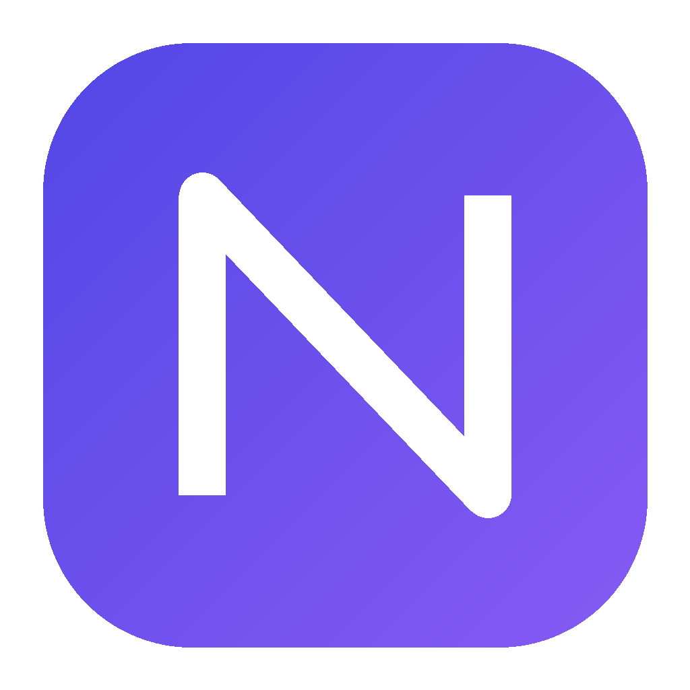

<div align="center">



# NEXORA

**One offline-first workspace for your tasks, notes, pages, projects, calendar, habits and clipboard.**
Works without internet. Syncs between your devices when you sign in. English and বাংলা.

[Download](https://github.com/nurulislamtask/NEXORA/releases) · [What works and what doesn't](docs/STATUS.md) · [Architecture](docs/ARCHITECTURE.md) · [Changelog](CHANGELOG.md)

</div>

> **Preview software.** Installers and the Android APK are built automatically by GitHub Actions and are **unsigned**. The code is covered by 69 automated tests and compiles on Windows, Linux, macOS and Android, but nobody has yet run the installed app on a real device. The downloadable builds also contain **no cloud backend**, so they run local-only until built with your own Supabase settings (see below). Expect rough edges and please report them. Details: [docs/STATUS.md](docs/STATUS.md).

## Download

Get the newest file from the [Releases page](https://github.com/nurulislamtask/NEXORA/releases) (look for the highest `v0.1.0-preview.N`).

| Platform | File | How to install |
|---|---|---|
| Windows 10/11 (64-bit) | `NEXORA_…_x64-setup.exe` (or `.msi`) | Double-click. Windows SmartScreen will warn because the file is unsigned: **More info → Run anyway**. |
| Android 7.0+ | `app-universal-debug.apk` | Open the file on the phone and allow "install unknown apps" for your browser/file manager. Built for 64-bit ARM phones. |
| macOS (Apple Silicon) | `NEXORA_…_aarch64.dmg` | Drag to Applications. First launch: right-click → Open (Gatekeeper warns about unsigned apps). |
| Linux (64-bit) | `.AppImage` or `.deb` | `chmod +x NEXORA_*.AppImage && ./NEXORA_*.AppImage`, or `sudo apt install ./NEXORA_*.deb`. |

## What's inside

| Feature | What you can do |
|---|---|
| **Tasks** | Priorities, due dates, repeat rules, subtasks, labels, "My Day", manual drag/↑↓ ordering, multi-select bulk actions (complete, priority, project, archive, delete), trash |
| **Notes** | Rich text, labels, pinning, full-text search (works for Bangla too), sticky-note windows that float above other apps (desktop) |
| **Pages** | Notion-style page tree with sub-pages and blocks: text, heading, to-do, bullet, quote, code, divider |
| **Projects** | Group tasks, deadline, status, progress bar, overdue count |
| **Calendar** | Month view of events and due tasks; all-day, multi-day and repeating events |
| **Habits** | Daily/weekday/weekend/custom schedules, streaks, 30-day strip |
| **Clipboard history** | Off by default. Local-only, skips passwords/tokens/card numbers, pin and convert items to notes or tasks |
| **Reminders** | In-app banner with snooze, plus system notifications |
| **Search and shortcuts** | `Ctrl/⌘ + K` (or `P`) command palette searching everything; `Ctrl/⌘ + N` new note; `Ctrl/⌘ + Shift + N` new task |
| **Backup and restore** | Checksummed JSON backup file; restore by merging or by making the device match the backup (a safety backup is taken first) |
| **Themes** | 14 built-in themes, light/dark follow-system, plus a custom theme editor that refuses unreadable colour combinations |
| **Languages** | English and বাংলা, switchable at any time |
| **Account and sync** | Email sign-in, offline-first sync across devices with conflict copies instead of silent overwrites, account deletion |
| **Updates** | Settings → Updates checks GitHub for a newer release and links to the download |

## Your data and privacy

- Everything is stored in a local SQLite database on your device first. The app is fully usable offline and without an account.
- If you sign in, your tasks, notes, pages, projects, events and habits sync to **your own** Supabase project, protected by row-level security so each account can only read its own rows. The app only ever contains the public anon key, never a service key.
- The saved login session is encrypted (AES-256-GCM); the key lives in the OS keychain on desktop. On Android there is no keychain backend yet, so you sign in again after each restart.
- Clipboard history never leaves the device: it is not synced and not included in backups. In the desktop app, when you turn it on, the clipboard is checked every 2 seconds while NEXORA is running; nothing is read when the app is closed.

## Set up cloud sync (optional)

The app runs local-only until you connect a backend.

1. Create a free project at [supabase.com](https://supabase.com).
2. Apply the SQL in [`supabase/migrations`](supabase/migrations) in filename order (SQL editor, or `supabase db push`).
3. Copy `.env.example` to `.env` and fill in the project URL and **anon** key, then build the app yourself. To make GitHub Actions builds include it, add the repository *variables* `VITE_SUPABASE_URL` and `VITE_SUPABASE_ANON_KEY` (Settings → Secrets and variables → Actions → Variables; the anon key is public by design, never use the service-role key).

## Build from source

You need Node 22, a Rust toolchain and the [Tauri 2 prerequisites](https://v2.tauri.app/start/prerequisites/) for your OS.

```bash
npm install
npx tauri icon src-tauri/app-icon.png   # generates the platform icons once
npm test                                # 69 tests: data layer, sync, auth, i18n, UI render
npm run tauri dev                       # run the desktop app
npm run tauri build                     # make an installer
```

Android additionally needs JDK 17, the Android SDK/NDK and `rustup target add aarch64-linux-android`, then `npx tauri android init` and `npx tauri android build --apk --debug --target aarch64`.

## How releases are made

Push to `migrate/tauri-react` with `[build]` in the commit message to build all installers, or `[release]` to also publish them as a GitHub pre-release. Normal pushes run CI only: TypeScript, tests, Vite build, `cargo check`, and the Postgres security tests.

## Project layout

```
src/core/      logic with no UI: data (tasks, notes, pages…), sync engine, auth, i18n, themes, update check
src/app/       React screens and components
src-tauri/     Rust shell, local SQLite migrations, capabilities
supabase/      cloud schema, row-level security, tests
tests/         Node test suite (real SQLite, in-memory server double)
docs/          architecture, migration notes, honest status
```

## Known limitations

- No signed installers yet, so no automatic updates; update by downloading the new release.
- Android: sign in again after restart, no sticky-note windows, APK is debug-signed.
- Google sign-in and password-reset completion are not finished; avatar upload is not implemented.
- Page blocks are plain text (no bold/italic); calendar weeks start on Sunday; no drag-to-reschedule.
- No screenshots yet: the project has never been run in an environment where they could be taken. They will be added after the first on-device run.

## Contributing and security

See [CONTRIBUTING.md](CONTRIBUTING.md) and [SECURITY.md](SECURITY.md). Licensed under the [MIT License](LICENSE).
